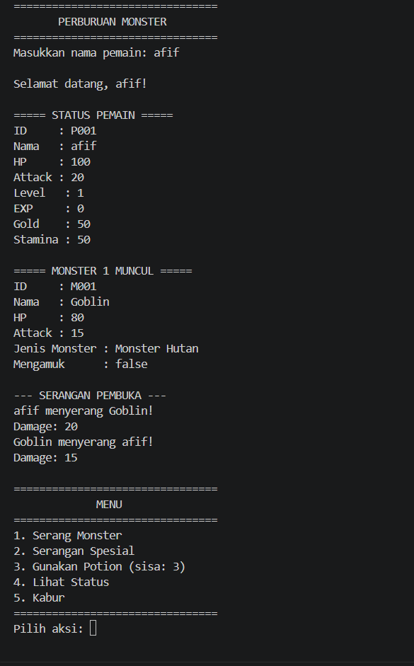
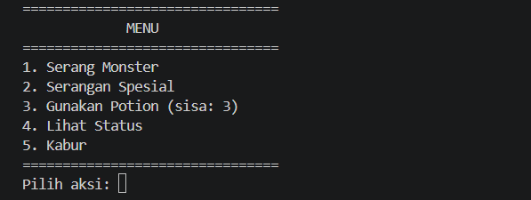
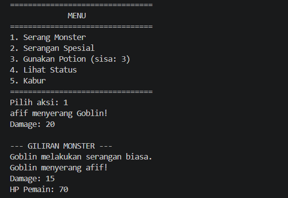
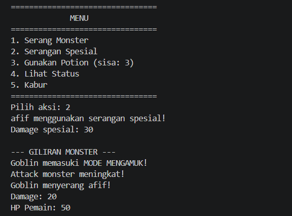
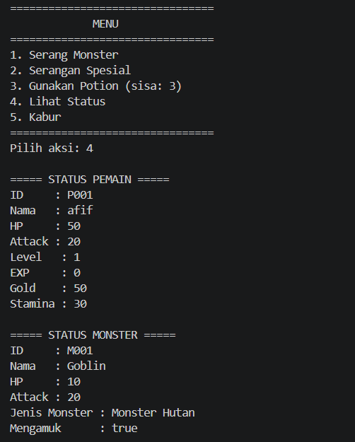
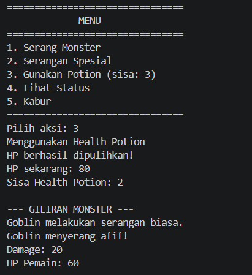
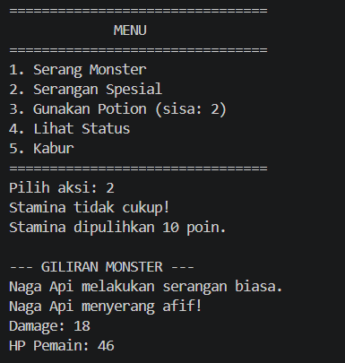
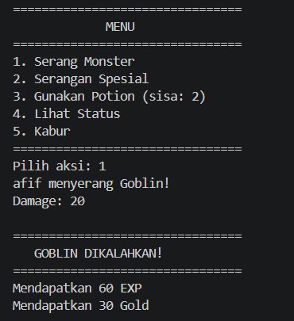
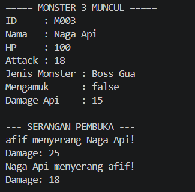
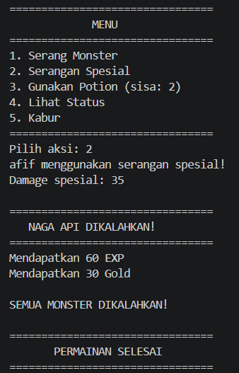

# Perburuan Monster

Game RPG turn-based berbasis terminal, dibuat dengan Java untuk Responsi Akhir Praktikum Pemrograman Berorientasi Objek.

## Identitas
| | |
|---|---|
| Nama | Afif Muflikhuddin |
| NIM | H1D025061 |
| Tema (digit terakhir NIM: 1) | Game |
| Mata kuliah | Praktikum Pemrograman Berorientasi Objek (Responsi Akhir) |
| Program Studi | Informatika, Fakultas Teknik, Universitas Jenderal Soedirman |

## Deskripsi Singkat
Pemain melawan tiga monster secara berurutan: Goblin, Slime, lalu boss Naga Api. Setiap pertarungan diawali serangan pembuka, kemudian pemain memilih aksi lewat menu.

| Menu | Aksi |
|---|---|
| 1 | Serang monster |
| 2 | Serangan spesial (butuh stamina 20) |
| 3 | Gunakan Health Potion (stok 3) |
| 4 | Lihat status pemain dan monster |
| 5 | Kabur |

Aturan singkat:
- Monster mengamuk (attack naik) saat HP-nya 30 atau kurang.
- Boss menyemburkan api setiap 3 giliran.
- Potion tidak memakan giliran jika HP masih penuh atau stok habis.
- Pemain naik level setelah EXP mencapai 100.

## Struktur Class
| File | Keterangan |
|---|---|
| `Karakter.java` | Superclass **abstract** (abstract method `aksiKhusus`) |
| `Pemain.java` | Subclass `Karakter`, implements `BisaBertarung, BisaMenggunakanItem` |
| `Monster.java` | Subclass `Karakter`, implements `BisaBertarung` |
| `Boss.java` | Subclass `Monster` |
| `Item.java` | Item pemulih HP (Health Potion) dengan stok |
| `BisaBertarung.java`, `BisaMenggunakanItem.java` | Interface |
| `Main.java` | Alur permainan interaktif |

## Pemetaan 10 Persyaratan
| No | Konsep | Lokasi |
|---|---|---|
| 1 | State dan Behavior | Atribut `hp`, `attack`, `stamina`, dll; method void `tampilkanInfo()`; method return `isHidup()`, `getHp()` |
| 2 | Immutability | `Karakter.MAX_HP`, `Pemain.MAX_STAMINA`, `Pemain.EXP_LEVEL_UP` (`public static final`); `Karakter.idKarakter` (`private final`) |
| 3 | Enkapsulasi dan Overloading | Semua atribut private + getter/setter, `this`; konstruktor ganda di `Karakter` (3 dan 4 parameter), `Pemain` (2 dan 4 parameter), `Monster` (4 dan 5 parameter) |
| 4 | Inheritance | `Pemain` dan `Monster` extends `Karakter`; `Boss` extends `Monster`; `Main` terpisah |
| 5 | Super Chaining | `super(...)` di konstruktor `Pemain`, `Monster`, `Boss`; `super.serang()`, `super.tampilkanInfo()`, `super.aksiKhusus()` (di `Boss`) |
| 6 | Method Overriding | `@Override` pada `serang()`, `tampilkanInfo()`, `aksiKhusus()`, `bertarung()` |
| 7 | Abstract Class | `abstract class Karakter` dengan `abstract void aksiKhusus(Karakter)` |
| 8 | Logika State Percabangan | if/else di `Pemain.aksiKhusus()` (stamina), `Monster.aksiKhusus()` (HP dan status mengamuk), `Boss.aksiKhusus()` (hitungan giliran) |
| 9 | Polimorfisme Interface | `BisaBertarung petarung = pemain;` lalu `petarung.bertarung(monster)`; serangan pembuka memakai `BisaBertarung[] peserta = { pemain, monster }` di `Main` |
| 10 | Multiple Interface | `Pemain implements BisaBertarung, BisaMenggunakanItem` |

## Cara Compile dan Run (Terminal)
Prasyarat: JDK 17 atau lebih baru (cek dengan `javac -version`).

```bash
git clone https://github.com/afifmuflikhuddin/Afif-Muflikhuddin_H1D025061_Shift-A_Shift-C_Nomor-1
cd [Afif-Muflikhuddin_H1D025061_Shift-A_Shift-C_Nomor-1]
javac *.java
java Main
```

Setelah dijalankan, ketik nama pemain, lalu pilih menu dengan angka 1 sampai 5.

## Screenshot Luaran Program

### 1. Awal permainan
Input nama pemain, status awal pemain, kemunculan monster, dan serangan pembuka.



### 2. Menu pertarungan
Daftar menu aksi beserta sisa stok Health Potion.



### 3. Serang biasa (menu 1)


### 4. Serangan spesial (menu 2)
Mengurangi stamina dan memberi damage lebih besar.



### 5. Lihat status (menu 4)
Status pemain (HP, attack, level, EXP, gold, stamina) dan status monster.



### 6. Gunakan Health Potion (menu 3)
HP pemain pulih dan stok potion berkurang.



### 7. Monster mengamuk
Attack monster naik saat HP-nya 30 atau kurang.



### 8. Monster dikalahkan
Hadiah EXP dan gold, serta level up.



### 9. Boss Naga Api
Kemunculan boss dan semburan api setiap 3 giliran.



### 10. Kemenangan
Seluruh monster berhasil dikalahkan.

